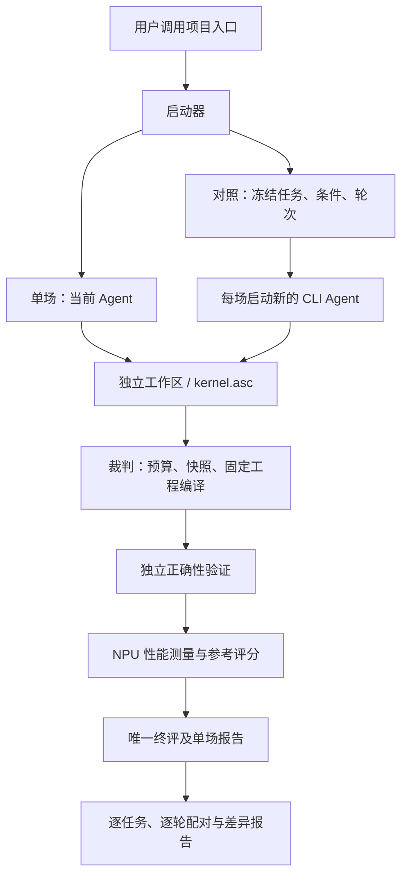

# 架构与运行模型

## 1. 四个职责

| 组件 | 职责 | 主要代码 |
| --- | --- | --- |
| 题目包 | 题意、接口、起点、固定工程、数据、oracle 与性能协议 | [problems](../problems)、[题包加载](../engine/problems.py) |
| 裁判服务 | 准入、预算、源码快照、正确性、性能、终评与可信报告 | [service.py](../service.py)、[controller.py](../engine/controller.py)、[budget.py](../engine/budget.py) |
| 启动器与实验驱动 | 分配/恢复会话，冻结实验计划，为各 trial 提供方法并启动 CLI | [launch.py](../launch.py)、[research.py](../engine/research.py)、[experiment.py](../experiment.py) |
| 待测 Agent | 读取当前题目与方法，在预算内实现/优化 kernel，使用反馈 | [入口模板](../launch_routes.py)、[工作区工作流](../workspace.py) |

题目不负责管理 CLI、HTTP 或实验预算；实验驱动也不根据模型自己的说法评分。Agent 的进程退出码只表示 CLI 执行情况，最终任务结果来自裁判。

CPU 样例经过编译、运行和正确性，但没有 NPU 性能分。失败阶段不会虚构后续性能结果。

## 2. 单场评测

1. 管理员预先配置 launcher，绑定题包、参考基线、用途与预算。凭据存于项目私有 `.eval/launcher.json`。
2. `launch.py` 向服务申请准备。网络重试复用同一 request ID；已有活动题目/轨道会话被复用。工作区处于 `PENDING`，还未计时。
3. Agent 执行 `./eval start`，取得资源后进入 `OPEN` 并启动任务时钟；资源忙时不把等待计作任务时间。
4. `check/bench` 提交 kernel 文本，裁判预留一次反馈并按 SHA256 存储源代码快照，使用受信工程运行。客户端不能通过请求替换编译命令、oracle 或预算。
5. `final` 对历史版本独立重判。它是唯一终评；已经受理就关闭后续反馈。计量/基础设施错误有独立状态，不能一律当 Agent 0 分。
6. 报告保存终评结果和全部反馈历史；最终会话可为 `FINISHED`、`EXPIRED` 或 `CANCELLED`。终态本身不等于正确通过，必须查看 outcome。

内置任务的默认上限为 20 次反馈和 3600 秒；结束后的 600 秒宽限只允许选择历史源码。自动收尾规则见 [评测政策](../EVALUATION_POLICY.md)。

## 3. 一组方法实验

`experiment.py` 读取用户配置、计算方法和 runner 摘要，并调用服务中的 Research 接口。服务在第一场前冻结所有任务、条件、轮次、轨道、预算和基线身份。

每个 trial 对应一份独立会话。方法以 METHOD.md / method 文件传入；新的 CLI 不继承上一个 trial 的 kernel 或反馈。计划中任务数 × 条件数 × repeats 是总场数。默认串行执行，不把多个候选同时送入共享 NPU。

两条件的执行顺序随轮次 A→B / B→A 交替；同任务同轮次的条件共享隐藏输入种子。不是随机对照分配，也不产生自动显著性结论。参考 baseline 和种子绑定由服务保存，候选不能从公开 manifest 读到隐藏种子。

驱动返回后，根据裁判的已提交历史收尾；不存在历史源码时记录无终评，不拿当前未提交文件补考。比较模块纳入全部计划 trial，并检查配对身份。源码和方法的不同是研究变量；题包、轨道、预算和测量环境的不一致则可能使配对失效。

## 4. 幂等与恢复

| 对象 | 稳定身份与行为 |
| --- | --- |
| 单次提交 | session + request ID；相同请求不重复扣费和执行 |
| 单场启动请求 | launcher + request ID；重放仍指向原会话，不刷新预算 |
| 实验配置 | 规范化计划、方法内容和 runner 摘要；同配置恢复原实验 |
| trial | experiment + trial ID；分配写入日志，READY 重放原会话 |
| Agent 执行 | started/execution 记录；不明确旧进程状态时拒绝启动第二个 CLI |

`--new` 是显式创建新实验，不是重试开关。原计划未完成时不能用它掩盖失败。活动驱动通过文件锁防止并发启动；报告以原子文件替换避免下载部分写入的内容。

数据库必须位于节点本地磁盘。题包、快照和报告可以放受控共享存储，但 SQLite WAL 不应放 NFS。数据库缺失、worker 丢失或进程状态不明都需要保留证据并按 [故障排查](TROUBLESHOOTING.md) 处理，不通过清空状态恢复额度。

## 5. 本机与服务器

单场模式可以让 Agent 在本机编辑 kernel，经 SSH loopback 转发调用远端裁判。compare 的 `experiment_remote` 则将配置和方法快照上传服务器，在服务器启动 CLI；两种路径中运行 Agent 的位置不同。

远程驱动只取回 REPORT.md、comparison.json、trials.json、manifest.json。完整 trial 工作区和原始 CLI 日志留在服务器。断开 SSH 不证明远端进程已停止，未知状态必须先检查；不能承诺所有异常都会无人干预恢复。

## 6. 题目与版本身份

题包文件内容计算包摘要；协议、参考源码、计量引擎和环境身份参与基线校验。题包、协议或测量代码改变后，旧时间不能自动充当新版本参考。导出公共代码保留题包原始字节，运行数据不入源代码包。

内置 `case01`–`case15` 是生成的固定 shape 子包，每题独立标定；不是从 full 的时间向量剪出一项。full 保持原题包及 15 个 shape 的汇总口径。新增算子接入契约见 [OPERATOR_SPEC](OPERATOR_SPEC.md)；新增通用任务目录还需额外实现和测试。

## 7. 信任边界

当前独立工作区、新 CLI、数据库策略和固定工程提供的是开发流程约束，不是 OS 隔离。候选 C++ 的 Host 与载体仍共处进程；同账号 Agent 可能访问其他文件。公开代码包包含参考和测试实现，不能同时宣称这些内容对能读仓库的 Agent 不可见。

因此报告始终明确研发用途、模型身份未认证及无正式排名资格。使用者应记录题库/参考是否可见，不能把提示词禁读当成已经实施的隐藏。安全现状与未来隔离要求见 [安全设计](../SECURITY_DESIGN.md)。
